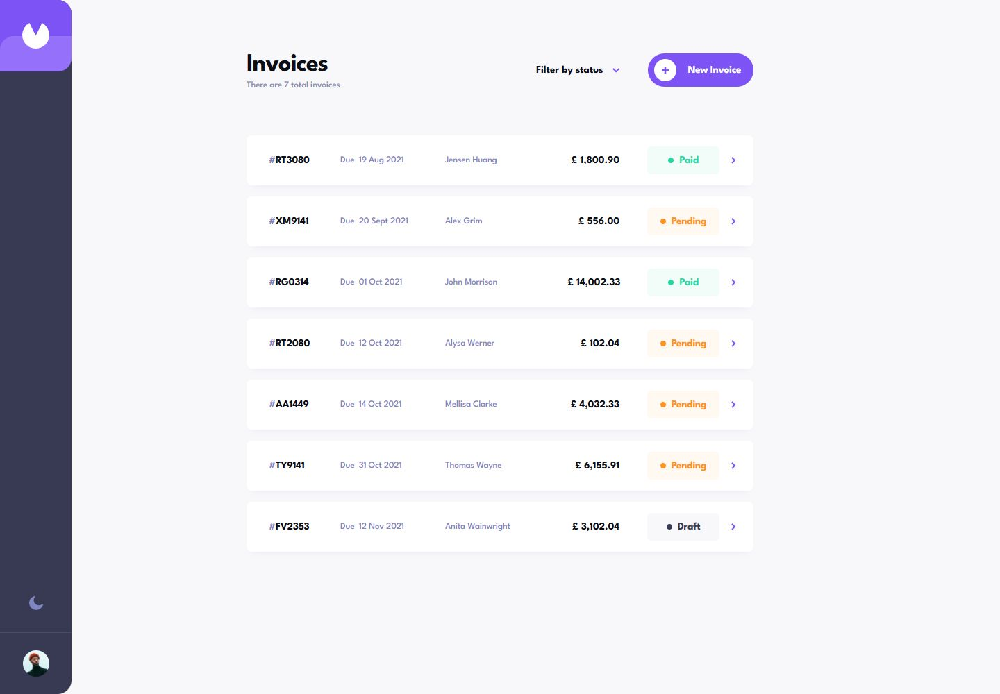
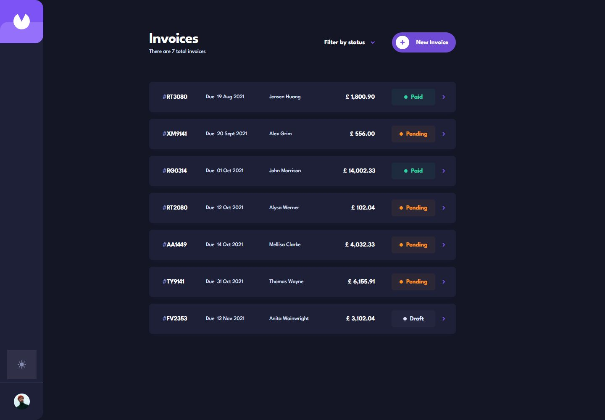
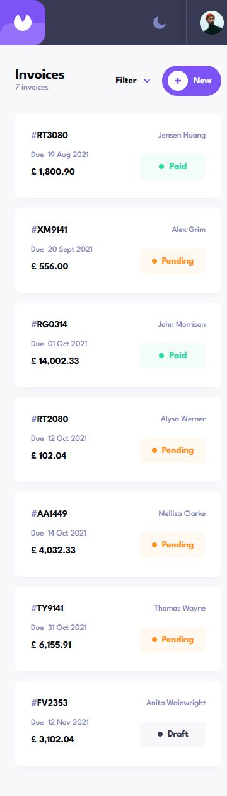
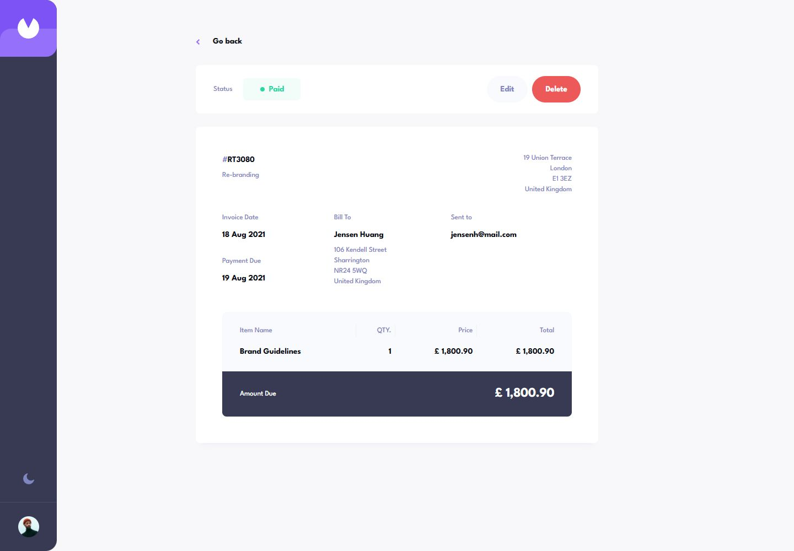
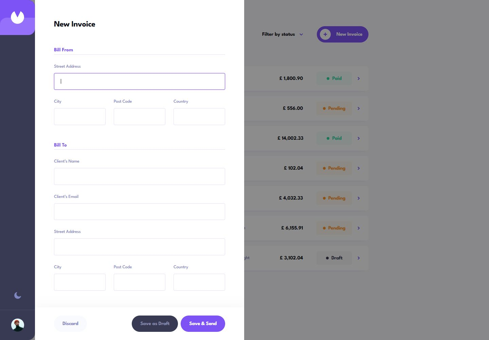

# Invoice App

A responsive invoice manager built with Next.js, React, TypeScript, Ant Design, and Zustand, based on the supplied Frontend Mentor Figma designs. Create invoices, manage drafts, and track payment status in light or dark mode.

## Live Demo

[Open Invoice App](https://invoice-app-azure-ten.vercel.app/)

Invoices and theme preferences are stored in your browser. Changes are not synchronized between devices. **Save & Send** saves an invoice as pending; it does not send an email.

## Screenshots

Captured from the live deployment.

### Desktop — Light



### Desktop — Dark



### Mobile



### Invoice Details



### Invoice Form



## Features

- Create invoices or save incomplete drafts, then edit them later.
- Add and remove line items, with calculated totals and payment due dates.
- Validate required fields, email addresses, quantities, and prices before saving a completed invoice.
- Move completed drafts to pending, mark pending invoices as paid, and confirm before deleting.
- Filter by multiple invoice statuses and open individual invoice detail routes.
- Use responsive list, detail, and form layouts with mobile action bars.
- Switch between light and dark themes, with invoices and theme preferences retained across refreshes.
- Navigate with labelled controls, a skip-to-content link, and focus on the first invalid form field.

## Tech Stack

| Area | Technology |
| --- | --- |
| Framework | Next.js 16 (App Router), React 19 |
| Language | TypeScript |
| UI | Ant Design 6, custom CSS |
| State and persistence | Zustand 5, localStorage |
| Date input support | Day.js |
| Testing | Node.js test runner, Cypress |
| Tooling | pnpm, ESLint |

## Architecture

The invoice feature groups its UI, business rules, and state together:

```text
app/
  invoices/[id]/            Invoice detail route
  _components/             Reusable presentation components
  _data.json               Initial invoice records
  globals.css              Layout and responsive styles
features/invoices/
  components/              App shell, list, details, create/edit form
  lib/invoice.ts           IDs, validation, dates, totals, formatting
  store.ts                 Invoice actions, theme, persisted state
public/assets/             Design assets
tests/                     Invoice rule tests
cypress/e2e/               Browser tests
```

Next.js handles routing and the root layout. Interactive components use client boundaries, and the invoice detail screen handles missing records.

Ant Design `Form`, `Form.Item`, and `Form.List` manage form fields, validation, and dynamic line items. Incomplete drafts bypass required-field validation. `ConfigProvider` supplies light/dark theme tokens and component defaults; custom CSS handles the supplied design's layout and responsive behavior.

Invoice calculations and validation helpers live separately from the UI in `lib/invoice.ts`. The Zustand store handles saving, deleting, marking pending invoices paid, and switching themes. Explicit hydration restores saved state before invoice lookup or creation.

This is a frontend application. The store persists invoices and theme preferences under `invoice-app-v1` in localStorage, using `app/_data.json` as initial data. Clearing that storage resets the saved state.

## Testing

| Command | Purpose |
| --- | --- |
| `pnpm lint` | ESLint checks |
| `pnpm exec tsc --noEmit` | Application type checks |
| `pnpm test` | Invoice rule tests |
| `pnpm test:e2e:types` | Cypress type checks |
| `pnpm test:e2e` | Cypress against a dedicated development server |
| `pnpm test:e2e:production` | Build and run Cypress against a production server |
| `pnpm build` | Production build |

Unit tests cover date boundaries, monetary rounding, invoice validation, and ID generation. The Cypress suite contains **19 tests across three specs**, covering invoice creation and editing, drafts, status changes, filtering, deletion, missing records, persistence, and layouts at mobile (375px), tablet (768px), and desktop (1440px) widths.

The E2E scripts require Chrome, start a server on `http://localhost:3100`, run Cypress, and stop the server afterward. They use `.next-e2e` to keep the test build separate from the regular app. Tests initialize independent fixture data before hydration and clear browser storage between tests.

For interactive debugging, start `pnpm dev --port 3100`, then run `pnpm cypress:open` in another terminal. If the Cypress binary is missing, run `pnpm exec cypress install`.

## Frontend Mentor Attribution

This project implements the [Invoice app challenge on Frontend Mentor](https://www.frontendmentor.io/challenges/invoice-app-i7KaLTQjl). The visual design and supplied assets come from Frontend Mentor; this repository contains the application implementation. The private Figma source is excluded from version control.

## Run Locally

```sh
pnpm install
pnpm dev
```

Open [localhost:3000](http://localhost:3000). For a production build, run `pnpm build`, then `pnpm start`.
